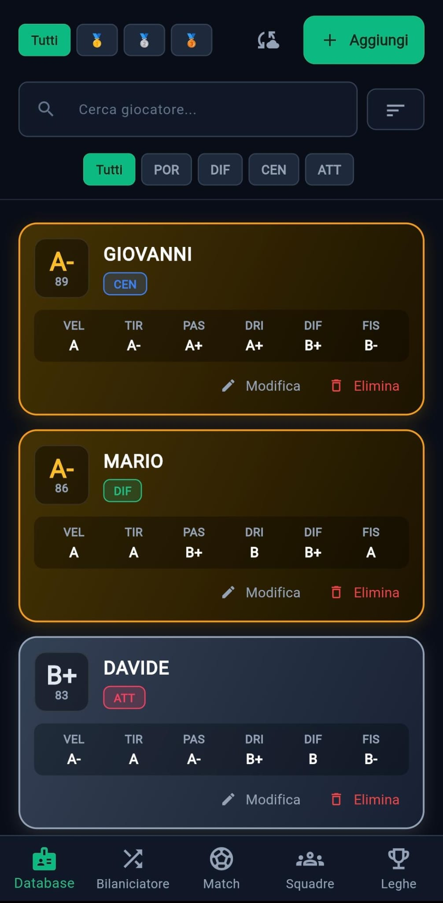
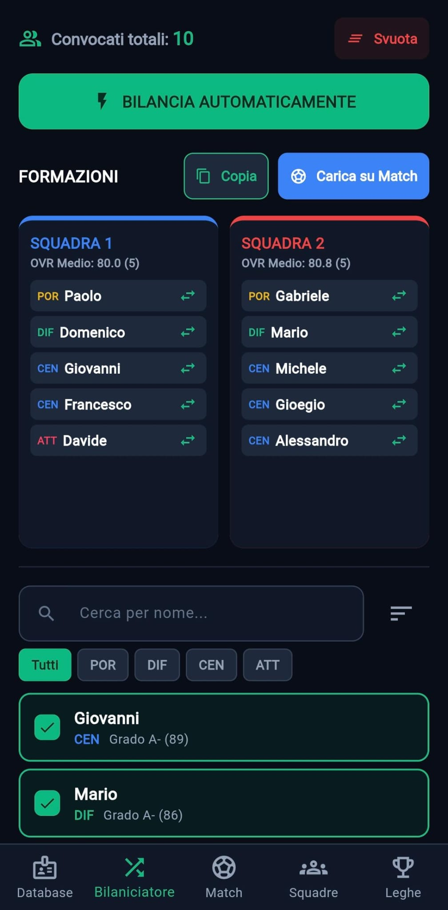
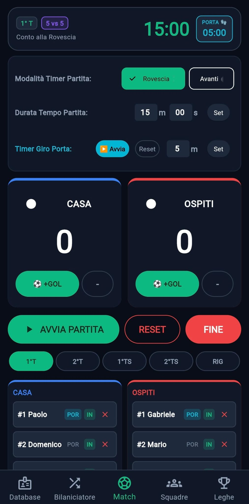
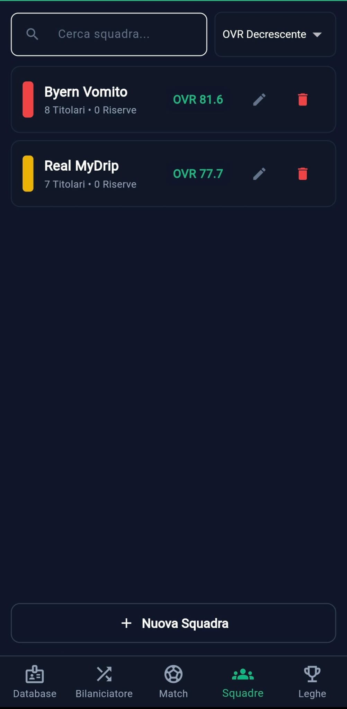
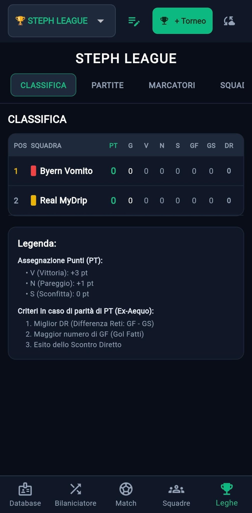

# ⚽ Football Steph

**La piattaforma completa offline-first sviluppata in Flutter per gestire partite amatoriali di calcetto, formazioni bilanciate, club, tornei a classifica e pagelline automatiche.**

---

**Football Steph** è un'applicazione mobile e web sviluppata in Flutter dedicata alla gestione a 360° del calcetto tra amici. Permette di creare un database atleti con statistiche in stile card collezionabili, generare formazioni bilanciate automaticamente o gestire squadre fisse (Club), tracciare il tabellino live minuto per minuto, organizzare interi campionati con classifica in tempo reale e consultare cronaca, MVP e pagellini automatici a fine gara.

---

## 📱 Screenshots

  
  
  
  
  

---

## 🚀 Funzionalità Principali

### 👥 Database Atleti
- **Schede Stile FUT**: Valutazione complessiva (OVR) calcolata su voti da `C-` ad `A+` con fasce Oro, Argento e Bronzo.
- **Ruoli Differenziati**: Gestione Portieri (`POR`), Difensori (`DIF`), Centrocampisti (`CEN`) e Attaccanti (`ATT`) con pesi specifici e codici colore dedicati.
- **Ricerca & Filtri Rapidi**: Filtra istantaneamente per nome, ruolo, metallo e ordina per OVR o ordine alfabetico.
- **Backup & Ripristino**: Esportazione e importazione tramite file JSON senza sovrascrittura distruttiva (merge intelligente).

### ⚖️ Bilanciatore & Squad Builder
- **Vincolo Numerico Rigido**: Distribuzione perfettamente simmetrica dei convocati selezionati.
- **Separazione dei Portieri**: Assegnazione equa dei portieri tra le due formazioni.
- **Algoritmo a Scambi Intra-Ruolo**: Minimizza lo scarto di OVR medio scambiando atleti con lo stesso ruolo.
- **Scambio Manuale & Condivisione**: Pulsante rapido per invertire singoli giocatori tra le due squadre, copiare le distinte formattate per **WhatsApp** o inviarle direttamente allo Scoreboard Live.

### 🛡️ Gestione Squadre (Club Fissi)
- **Creazione Club Personalizzati**: Crea squadre permanenti con nome e colore sociale dedicato.
- **Gestione Rosa, Titolari & Numeri**: Assegna i giocatori alla rosa, imposta i numeri di maglia personalizzati e scegli chi parte titolare (`IN`) o in panchina (`OUT`) con calcolo automatico dell'OVR medio dei titolari.
- **Lancio Rapido Match**: Seleziona Casa vs Ospiti e avvia istantaneamente l'amichevole con rose e colori preimpostati.
- **Import/Export Rose**: Backup JSON dedicato anche per l'archivio squadre.

### ⏱️ Scoreboard Live & Cronaca
- **Gestione Tempi Completa**: 1° Tempo, 2° Tempo, Tempi Supplementari (`1°TS`, `2°TS`) e Sequenza Calci di Rigore.
- **Tracking Eventi Dettagliato**: Gol, Assist, Autogol, Ammonizioni, Espulsioni, Sostituzioni, Rigori Parati/Sbagliati, Falli, Errori, Buone Giocate e Occasioni Create/Sbagliate.
- **Timer & Cronometro Individuale**: Monitoraggio in tempo reale del minutaggio complessivo in campo e del tempo specifico giocato in porta per il bonus *Clean Sheet*.

### 🏆 Hub Tornei, Storico & Pagelline Automatiche
- **Gestione Campionati (Stile Lega)**: Crea infiniti tornei personalizzati iscrivendo le tue squadre. Ogni torneo dispone di 4 schede dedicate (*Classifica*, *Partite*, *Marcatori*, *Squadre*):
  - **Classifica Automatica**: Calcolo in tempo reale di Punti (`PT`), Giocate (`G`), Vinte (`V`), Pareggiate (`N`), Sconfitte (`S`), Gol Fatti (`GF`), Gol Subiti (`GS`) e Differenza Reti (`DR`).
  - **Gestione Ex-Aequo**: Ordinamento automatico in caso di arrivo a pari punti basato su Differenza Reti $\rightarrow$ Gol Fatti $\rightarrow$ Scontro Diretto.
- **Filtro Competizioni**: Passa in un tocco dallo **Storico Globale** (tutte le partite) a **Solo Amichevoli** o ai singoli **Tornei**, con classifica marcatori e assist-man ricalcolata dinamicamente per la vista selezionata.
- **Pagelline Automatiche & Media Squadra**: Algoritmo che calcola il voto finale (scala `1.0 - 9.9`) combinando risultato di squadra, minutaggio, bonus/malus ed eleggendo l'**MVP** del match tramite criteri di spareggio oggettivi. Include il calcolo della media voto complessiva di squadra (escludendo gli `S.V.`).
- **Design Voti a Colori**:
  - 🔵 **Blu Elettrico**: Migliore in campo (**MVP**)
  - 🟢 **Verde**: Prestazioni top ($\ge 6.8$)
  - 🟠 **Arancio / Ambra**: Sufficienza (da $5.8$ a $6.7$)
  - 🔴 **Rosso**: Insufficienza ($< 5.8$)
  - ⚫ **Grigio**: Senza Voto (`S.V.`, meno di 5 minuti giocati senza eventi)
- **Protezione Fase Rigori**: La lotteria dei rigori finali decreta il vincitore ma non altera i voti delle pagelle maturati durante il gioco.
- **Dettaglio Match a Schede**: Riepilogo post-partita diviso tra *👥 Formazioni & Voti* e *📜 Cronaca Saliente* suddivisa per tempi di gioco.

---

## 🛠️ Stack Tecnologico

- **Framework**: [Flutter](https://flutter.dev/) (Canale Stable)
- **Linguaggio**: Dart
- **Persistenza Dati**: `shared_preferences` (archiviazione locale JSON 100% offline-first)
- **Gestione File**: `file_picker` & `share_plus` per import/export multipiattaforma
- **Piattaforme Supportate**: Web (PWA), Android (APK), Windows/iOS

---

## 📖 Guide di Riferimento

Per suggerimenti su come assegnare i voti ai giocatori/amici in maniera oggettiva per rendere l'app quanto più equilibrata possibile, ho stilato questa [Guida ai Voti Atleti](guida-voti.md).  
Per approfondire invece la matematica dietro il calcolo automatico delle pagelle post-partita e i bonus/malus, puoi consultare la [Guida ai Pagellini](guida-pagellini.md).
